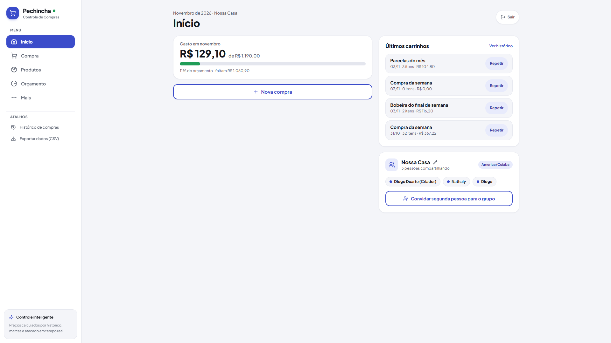
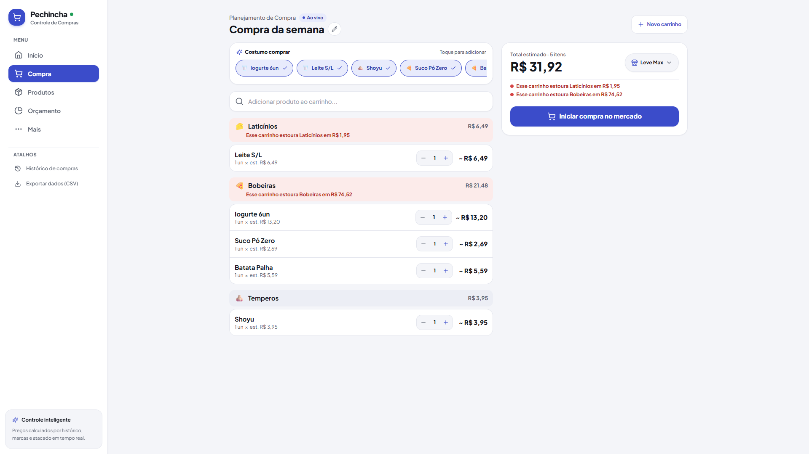
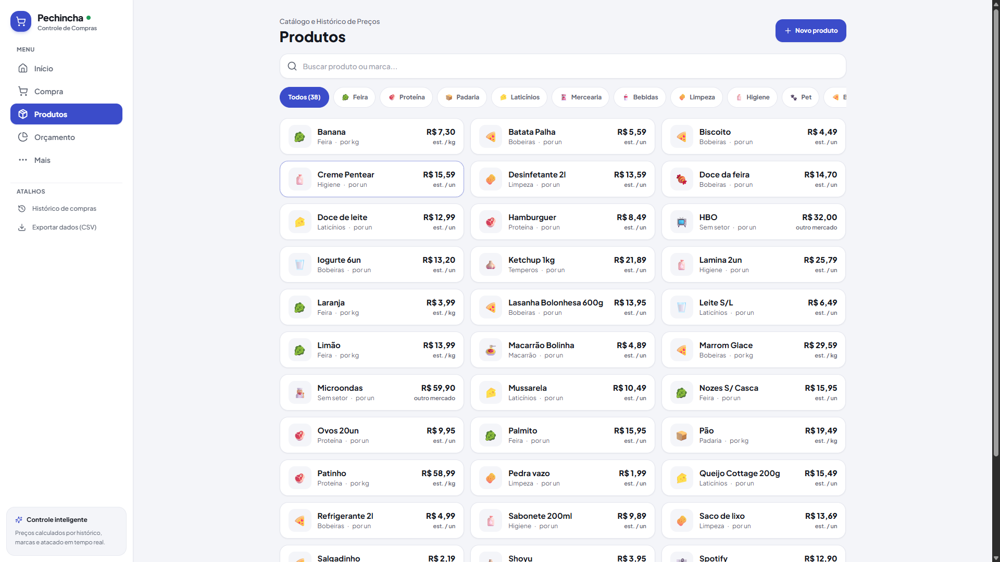
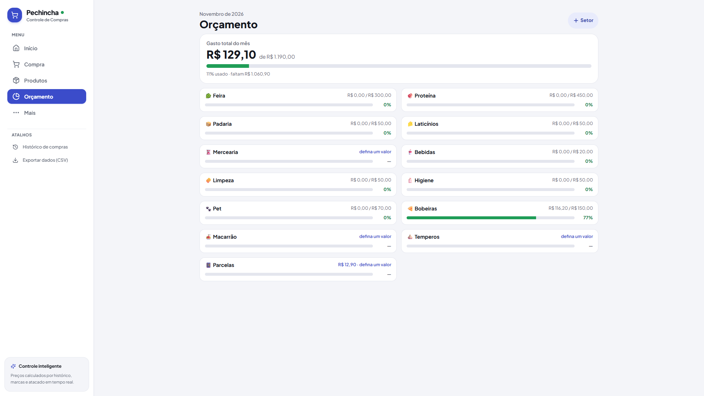

# Pechincha

Aplicação web para planejamento colaborativo de compras de mercado, registro de histórico de preços por estabelecimento e controle de orçamento mensal por categoria.

Deploy em produção: [pechincha-two.vercel.app](https://pechincha-two.vercel.app)

---

## Telas da Aplicação

<p align="center">
  
  
</p>

<p align="center">
  
  
</p>

---

## Funcionalidades

- **Colaboração em Tempo Real:** Sincronização de listas e carrinhos ativos entre dispositivos via Supabase Realtime, permitindo compras simultâneas no mesmo mercado.
- **Modo Mercado:** Interface otimizada para uso mobile em loja física, com teclado numérico 3x4 integrado para entrada rápida de centavos e pesagem (KG), ordenação de setores pelo layout físico do mercado e suporte a pagamento misto.
- **Histórico de Preços e Estimativas:** Registro automático de preços por estabelecimento, marca e data, com projeção do custo da compra antes de ir ao mercado (baseada em média móvel de 3 meses, último preço ou menor valor histórico).
- **Variações de Itens:** Suporte ao agrupamento de quantidades ou separação em linhas distintas para registrar marcas, sabores e valores diferentes de um mesmo produto.
- **Controle Orçamentário:** Definição de limites mensais globais e por setor (hortifrúti, açougue, limpeza, etc.), com sinalização visual de aproximação (80%) e estouro de teto.
- **Resiliência Offline:** Fila local via `localStorage` com remapeamento de IDs temporários para reconciliação automática de dados em locais sem sinal 4G/Wi-Fi.
- **Acesso para Avaliação (Modo Visitante):** Autenticação em um clique com ambiente isolado para testes rápidos da interface.
- **Exportação e Backup:** Extração dos dados em CSV e rotina completa de backup/restauração em JSON.

---

## Stack Tecnológica

- **Front-end:** Next.js 15 (App Router), React 19, TypeScript
- **Estilização:** Tailwind CSS, Lucide React
- **Banco de Dados & Autenticação:** Supabase (PostgreSQL 15, Auth via SSR cookies, Row Level Security estrito por grupo, Realtime)
- **Armazenamento Local:** Web Storage API / Service Worker
- **Infraestrutura:** Vercel (Edge Runtime e Serverless Functions)

---

## Execução Local

### Pré-requisitos
- Node.js 18.18+ ou 20+
- npm, pnpm ou yarn
- Instância configurada no Supabase

### Passo a passo

1. Clone o repositório:
```bash
git clone https://github.com/diogold01/pechincha.git
cd pechincha
```

2. Instale as dependências:
```bash
npm install
```

3. Configure o banco de dados:
Execute o script [`supabase/schema.sql`](supabase/schema.sql) no SQL Editor do Supabase para criar as tabelas, triggers e políticas de segurança (RLS).

4. Configure as variáveis de ambiente:
Crie o arquivo `.env.local` na raiz:
```env
NEXT_PUBLIC_SUPABASE_URL=https://seu-projeto.supabase.co
NEXT_PUBLIC_SUPABASE_ANON_KEY=sua-chave-anon-publica
```

5. Inicie o servidor:
```bash
npm run dev
```
Acesse [http://localhost:3000](http://localhost:3000).

6. Build de produção:
```bash
npm run build
```
