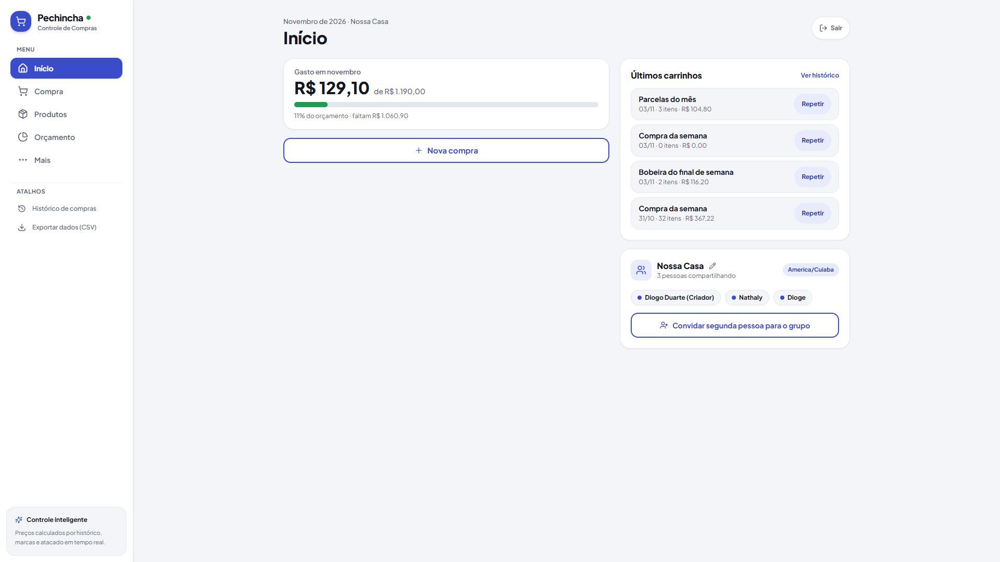
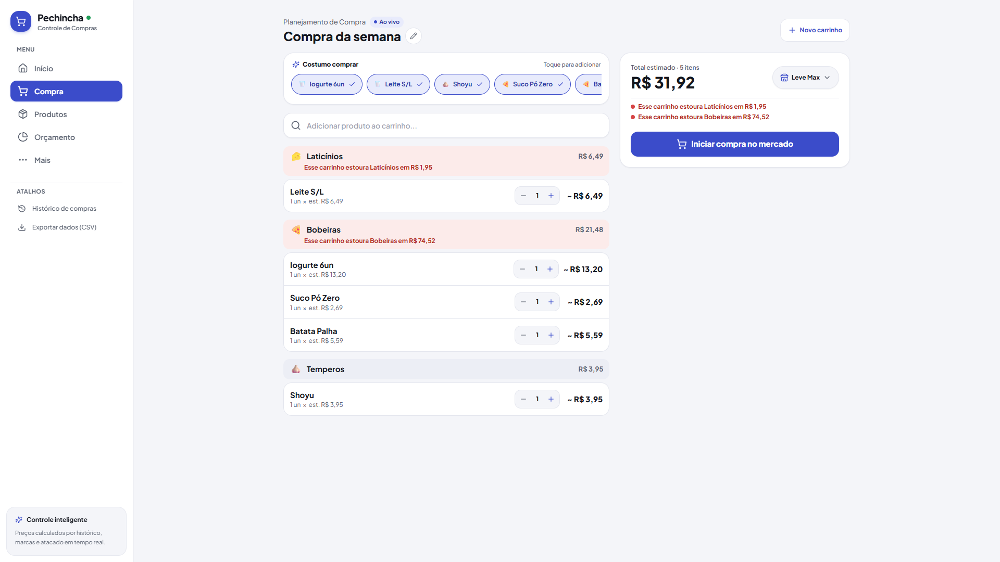
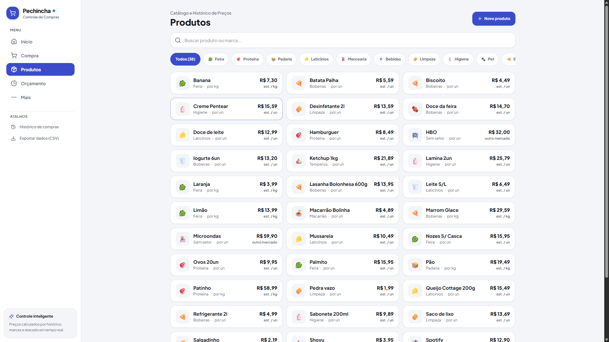
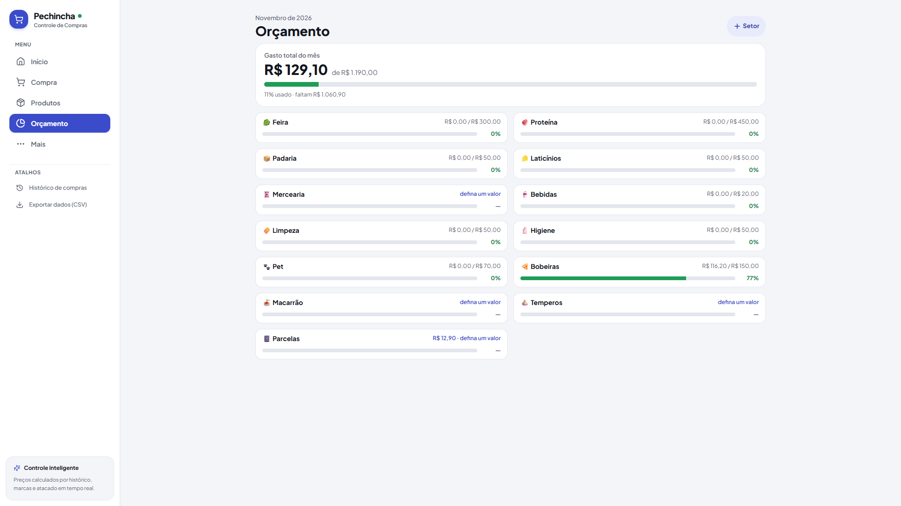

# Pechincha

Aplicação web colaborativa para planejamento de compras de supermercado, histórico de preços por estabelecimento, leitura de cupons fiscais (NFC-e/DANFE) com inteligência artificial e controle de orçamento mensal.

Aplicação no ar: [pechincha-two.vercel.app](https://pechincha-two.vercel.app)

---

## Telas da Aplicação

<p align="center">
  
  
</p>

<p align="center">
  
  
</p>

---

## O Problema e a Solução

Controlar gastos de supermercado em casal ou família costuma esbarrar em dois problemas: listas espalhadas em aplicativos de mensagem sem estimativa real de custo e cupons fiscais com descrições abreviadas (`"BISC RECH CHOC 140G"`, `"LIMP MULT 500ML"`) que dificultam manter um histórico limpo de preços por produto e mercado.

O Pechincha resolve essa rotina unificando o planejamento de compras, o acompanhamento de preços praticados em cada estabelecimento e a importação assistida por IA de notas fiscais para alimentar o catálogo sem digitação manual pesada.

---

## Como a IA Funciona (Google Gemini)

A integração com a API do Google Gemini atua em dois fluxos principais, sempre com validação humana antes de salvar:

- **Leitura e limpeza de cupom fiscal (`src/app/api/cupom/ia/route.ts`):** após extrair os itens brutos do cupom via QR Code pela câmera, upload de PDF (`unpdf`) ou consulta ao link da SEFAZ, o sistema envia a lista ao Gemini com schema estruturado (`responseSchema`) para traduzir abreviações fiscais, identificar marca e unidade de medida e associar cada linha aos produtos já existentes no catálogo do grupo.
- **Padronização de catálogo em lote (`CatalogAIFormatterModal`):** analisa os produtos cadastrados e sugere correções de nome, marca e categoria em uma tela de revisão comparativa (Antes e Depois), permitindo aprovar ou descartar item a item.
- **Contingência local (`src/lib/cupom-matcher.ts`):** quando a IA não é acionada, a vinculação entre os itens do cupom e o catálogo utiliza cálculo local de similaridade textual (distância de Levenshtein e sobreposição de palavras).

---

## Funcionalidades

- **Colaboração em tempo real:** sincronização de listas e carrinhos ativos entre dispositivos via Supabase, permitindo marcar itens simultaneamente durante a compra.
- **Modo Mercado:** interface adaptada para uso no celular dentro da loja, com teclado numérico integrado para preço e peso (kg), ordenação por setores e suporte a pagamento dividido.
- **Histórico de preços e estimativa de carrinho:** registro automático de preços por mercado, marca e data, projetando o valor total da lista com base na média recente, último preço pago ou menor valor registrado.
- **Controle de orçamento:** definição de teto mensal geral e por categoria (hortifrúti, açougue, limpeza, etc.), com alertas visuais ao atingir 80% ou ultrapassar o limite.
- **Fila de sincronização offline:** armazenamento temporário em `localStorage` para registrar itens mesmo em mercados com sinal instável de internet.
- **Modo visitante:** acesso imediato com um clique em ambiente de demonstração isolado.
- **Exportação e backup:** exportação de dados em CSV e rotina de backup/restauração em JSON.

---

## Limites Atuais

- A chave da API do Google Gemini é configurada pelo próprio grupo de usuários nas configurações da aplicação (modelo BYOK).
- A importação direta por URL da SEFAZ depende da disponibilidade e do layout público de cada portal estadual; quando o portal bloqueia leitura direta, o envio do PDF da nota ou a leitura do QR Code funcionam como alternativa.

---

## Stack

- TypeScript, React e Next.js (App Router)
- Tailwind CSS e Lucide React
- Supabase (PostgreSQL, autenticação com isolamento por grupo via RLS e sincronização em tempo real)
- Google Gemini API (interpretação estruturada de cupons fiscais e padronização de catálogo)

---

## Como Executar Localmente

### Pré-requisitos
- Node.js 18.18+ ou 20+
- Projeto configurado no Supabase

### Passo a passo

1. Clone o repositório e instale as dependências:
```bash
git clone https://github.com/diogold01/pechincha.git
cd pechincha
npm install
```

2. Execute o script [`supabase/schema.sql`](supabase/schema.sql) no SQL Editor do Supabase para criar as tabelas e políticas de acesso (RLS).

3. Crie o arquivo `.env.local` na raiz do projeto:
```env
NEXT_PUBLIC_SUPABASE_URL=https://seu-projeto.supabase.co
NEXT_PUBLIC_SUPABASE_ANON_KEY=sua-chave-anon-publica
```

4. Inicie o servidor de desenvolvimento:
```bash
npm run dev
```
Acesse `http://localhost:3000`.
